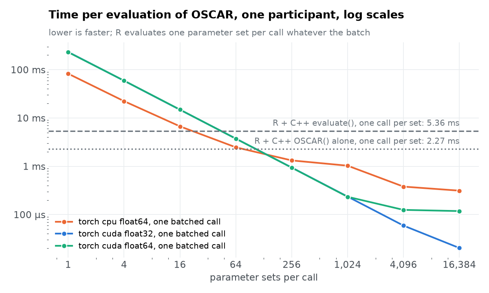
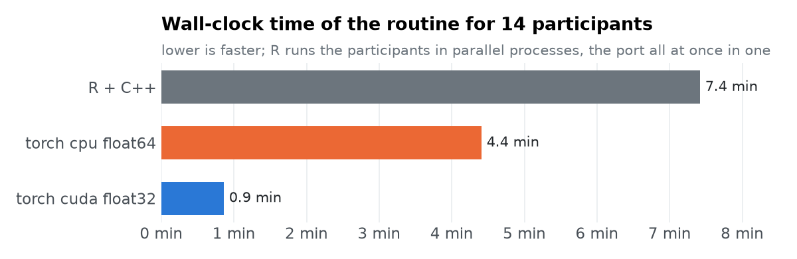

# OSCAR: R + RcppArmadillo against the torch port, CPU and GPU

## One call of the model

One participant (1,000 parameter sets for R, 3 repeats; 5 repeats per batch for torch). R calls the compiled `OSCAR()` once per parameter set, as `pspGlobal()` calls the model; `evaluate()` adds what the routine does around it (a fresh random initial state, and the data.table reduction to P(rare) at test). The port's `evaluate()` does all of that for the whole batch in one call; its time includes `discretize()`.

| R + RcppArmadillo | per evaluation |
| --- | --- |
| `OSCAR() alone` | 2.27 ms |
| `evaluate()` | 5.36 ms |

| batch | torch cpu float64 | torch cuda float32 | torch cuda float64 | vs R evaluate(), cpu float64 | vs R evaluate(), cuda float32 | vs R evaluate(), cuda float64 |
| --- | --- | --- | --- | --- | --- | --- |
| 1 | 82.57 ms | 232.44 ms | 230.44 ms | 0.065× | 0.023× | 0.023× |
| 4 | 22.30 ms | 59.04 ms | 59.24 ms | 0.24× | 0.091× | 0.091× |
| 16 | 6.70 ms | 14.82 ms | 14.89 ms | 0.8× | 0.36× | 0.36× |
| 64 | 2.47 ms | 3.74 ms | 3.73 ms | 2.2× | 1.4× | 1.4× |
| 256 | 1.32 ms | 940.3 µs | 936.6 µs | 4.1× | 5.7× | 5.7× |
| 1024 | 1.03 ms | 235.6 µs | 233.4 µs | 5.2× | 22.8× | 23.0× |
| 4096 | 379.3 µs | 59.1 µs | 125.0 µs | 14.1× | 90.7× | 42.9× |
| 16384 | 312.6 µs | 20.3 µs | 118.0 µs | 17.2× | 264.0× | 45.4× |

Fastest per evaluation: torch cpu float64 312.6 µs at 16,384 sets per call (17.2× R's `evaluate()`); torch cuda float32 20.3 µs at 16,384 sets per call (264.0× R's `evaluate()`); torch cuda float64 118.0 µs at 16,384 sets per call (45.4× R's `evaluate()`).

Where the GPU lines show one colour, float32 and float64 coincide: below a few thousand parameter sets per call the GPU's time is kernel launches (about 112 trials × 10 attention-shift iterations of small operations per call), not arithmetic, so the precision does not matter. The same fixed cost makes one torch call with a single parameter set some 35 times slower than one C++ call.

## The participant-level routine

The first 14 participants, 100 starting points (one matrix shared by all participants, as `psp.R`), radius 1, population 1,000,000 (so every pattern keeps proposing until the cap), 200 iterations, seed 2026. R runs `pspGlobal()` with the compiled OSCAR once per participant, spread over 14 forked processes (`psp.R` runs foreach over `detectCores() - 2`); its time is the wall clock of the whole parallel run. The port runs `notebooks/oscar/run_oscar.py --no-save`, every participant's search advancing in lockstep with one batched OSCAR call per iteration; its time is the wall clock of that whole process, Python's start-up, data loading and CUDA initialisation included.

| build | how | minutes, all participants | evaluations per second | speed-up vs R | patterns per participant | evaluations per participant |
| --- | --- | --- | --- | --- | --- | --- |
| R + C++ | 14 worker processes | 7.4 | 1,111 | 1× | 198–216, median 204 | 35,417 |
| torch cpu float64 | 1 process, lockstep | 4.4 | 1,864 | 1.7× | 194–215, median 205 | 34,916 |
| torch cuda float32 | 1 process, lockstep | 0.9 | 9,706 | 8.6× | 196–220, median 208 | 35,461 |

Each R participant took a median of 419 s in the parallel run; the same 35,417 evaluations at the 5.36 ms of a lone `evaluate()` come to about 190 s, so with 14 workers on 16 hardware threads each R process ran about 2.2 times slower than alone. That is the R routine as `psp.R` runs it on this machine; the port's CPU run used torch's own threads in one process.

Do they find the same inequality matrices? Per participant, against R:

| build | shared (median) | R only | torch only | share of evaluations in shared matrices (worst participant) |
| --- | --- | --- | --- | --- |
| torch cpu float64 | 196 | 8 | 6 | R 99.7%, torch 99.9% |
| torch cuda float32 | 198 | 6 | 9 | R 99.9%, torch 99.7% |

The model draws its initial state at random on every evaluation, and R and torch use different random numbers, so no two runs take the same path; matrices only one run found hold one or a few evaluations each.

## Machine

- CPU: AMD Ryzen 7 5800X 8-Core Processor, torch threads 8
- GPU: NVIDIA GeForce RTX 3060
- Linux 7.0.0-38-generic, Python 3.14.4, torch 2.11.0+cu128, R version 4.5.2 (2025-10-31)
- R side: psp 1.0.6 from CRAN in `benchmarks/oscar/r-lib`, OSCAR compiled from `benchmarks/oscar/tmp-models/` (`architecture.cpp` + `OSCAR.cpp`) with `Rcpp::sourceCpp()` and R's default flags (`-O2`).
