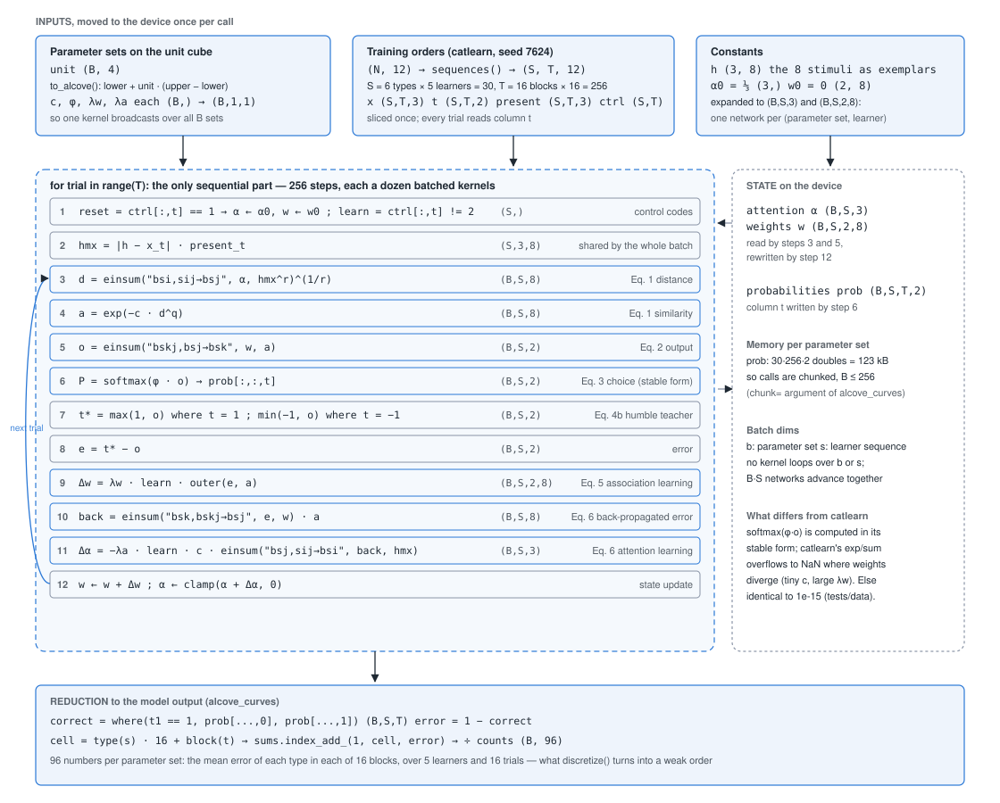
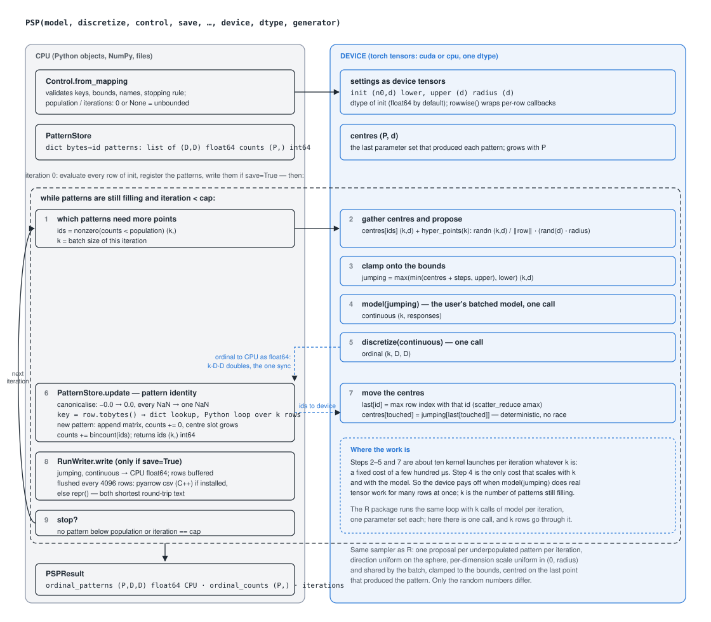

# Architecture

How ALCOVE was ported to run many parameter sets at once on the GPU, and how the parameter space partitioning sampler splits its work between the CPU and the device. The diagrams are generated SVG; open them in a browser or an SVG-capable viewer for full resolution.

## 1. ALCOVE as a batched tensor program

The `slpALCOVE()` of catlearn (Wills et al., 2025) runs one network through one list of trials. The port (`psp.models.alcove.alcove`) keeps the same trial loop but gives every tensor two leading batch dimensions, `b` for the parameter set and `s` for the learner sequence, so one pass of the loop advances B × 30 networks. No kernel ever loops over a parameter set or a learner; the only sequential dimension is the trial.

One call of `alcove_curves(unit, training)`: inputs are moved to the device once; the twelve operations inside the loop run once per trial for the whole batch; the state (attention and association weights) stays on the device between trials; the probabilities are reduced to 96 learning-curve values per parameter set at the end.

| | |
| --- | --- |
| Equations | Kruschke (1992) Eq. 1 (steps 3–4), Eq. 2 (5), Eq. 3 (6), Eq. 4b humble teacher (7), Eq. 5 (9), Eq. 6 (10–11), exactly as catlearn implements them, including the `r`/`q` exponents, missing-dimension flags, and the reset and freeze control codes. |
| einsum | The three contractions are written as `einsum` so the batch dimensions are explicit and the per-trial distance matrix `hmx`, which has no `b` dimension, is shared by every parameter set. |
| Masks, not branches | Reset and freeze trials are handled with `where` and a 0/1 `learn` factor, so sequences with different control codes still run in one batch. |
| Precision | Everything follows the dtype of the input: float64 reproduces catlearn to about 1e-15 (checked in the test suite against outputs exported from R); float32 is what makes a GPU worthwhile. |
| Cost | 256 trials × about 12 kernels ≈ 3,000 launches per call, whatever B is. That fixed cost is why one call with a batch of 1 takes the same time as a batch of 64 on the GPU, and why a sequential model gains less from the GPU than a dense one. |
| Memory | `prob` is the only tensor with a trial axis: 123 kB per parameter set in float64, so `alcove_curves` processes at most 256 parameter sets per call (`chunk`) and concatenates. |
| One divergence | The choice rule is computed as a stable softmax. Where catlearn's `exp(φo)/Σexp(φo)` overflows (specificity at its lower bound with a large association rate), catlearn returns NaN and the port returns the limiting probabilities. |

## 2. The sampler: what runs where

The algorithm is the R package's, iteration for iteration: every pattern still below `population` proposes one new parameter set within `radius` of the last set that produced it; all proposals are evaluated, matched to known patterns, and the loop repeats. The port changes one thing. Instead of calling `model` once per proposal, it hands the whole batch of proposals to `model` in one call, and keeps everything that batch touches on the device.

One iteration of `PSP()`. The left lane is Python on the CPU: the pattern store (a hash table keyed by the bytes of each pattern matrix), population counts and the csv writer. The right lane is torch on the device: centres, random proposals, clamping, the model and discretize calls, and the centre update. One copy of the new patterns crosses from device to host per iteration, and the pattern ids cross back.

| | |
| --- | --- |
| Batch size | k, the number of patterns still filling, is decided on the CPU from the counts and sets the size of every device tensor in the iteration. It is small at the start, largest in the middle of a run, and small again when only rare regions remain. |
| Device work | Gathering centres, drawing proposals with the device's own generator, clamping, the two callbacks, and the scatter that moves centres. About ten launches per iteration plus whatever the model costs. |
| CPU work | Pattern identity needs exact matching with `-0.0 == 0.0` and `NaN == NaN`, which a dict keyed by canonicalised bytes gives in one pass; counts are an int64 vector. Patterns are tiny (D × D doubles), so this stays cheap at thousands of rows per iteration. |
| Transfers | Per iteration: k·D·D doubles down (the ordinal patterns) and k int64 up (their ids). With `save=True`, the proposals and model outputs also come down to be buffered and written in 4,096-row chunks through pyarrow when it is installed. |
| Determinism | Centres are updated with `scatter_reduce(amax)` over row indices, so when several proposals land in the same pattern the last one wins on every device, as in the R package. |
| The contract | `model: (k, d) → (k, responses)` and `discretize: (k, responses) → (k, D, D)`. `rowwise(fn)` adapts functions written for one parameter set by looping and stacking, which restores the R package's call pattern and its cost. |
| Where time goes | For a model costing microseconds the fixed per-iteration cost dominates and the CPU wins. For a model doing real tensor work per row, the single batched call is the whole cost, and the device wins once k is large enough to fill it; the benchmarks notebook measures where that is. |

Many runs at once: `psp.PSPLockstep` keeps one pattern store per run and concatenates the proposals of every run into the single model call of each iteration, passing the run index of each row; the model routes each row to its own trial sequence (see `psp.models.oscar.evaluate` and `notebooks/oscar/run_oscar.py`).

Source files: `psp/_global.py` (the loop), `psp/_many.py` (many runs in lockstep), `psp/_store.py` (pattern store), `psp/_control.py` (settings), `psp/_io.py` (saving), `psp/models/alcove.py` (the model).

## References

Kruschke, J. K. (1992). ALCOVE: An exemplar-based connectionist model of category learning. *Psychological Review, 99*(1), 22–44. <https://doi.org/10.1037/0033-295X.99.1.22>

Wills, A. J., Dome, L., Edmunds, C., Honke, G., Inkster, A., Schlegelmilch, R., & Spicer, S. (2025). catlearn: Formal Psychological Models of Categorization and Learning. R package version 1.1. <https://CRAN.R-project.org/package=catlearn>
